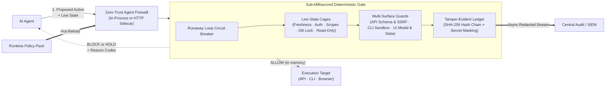
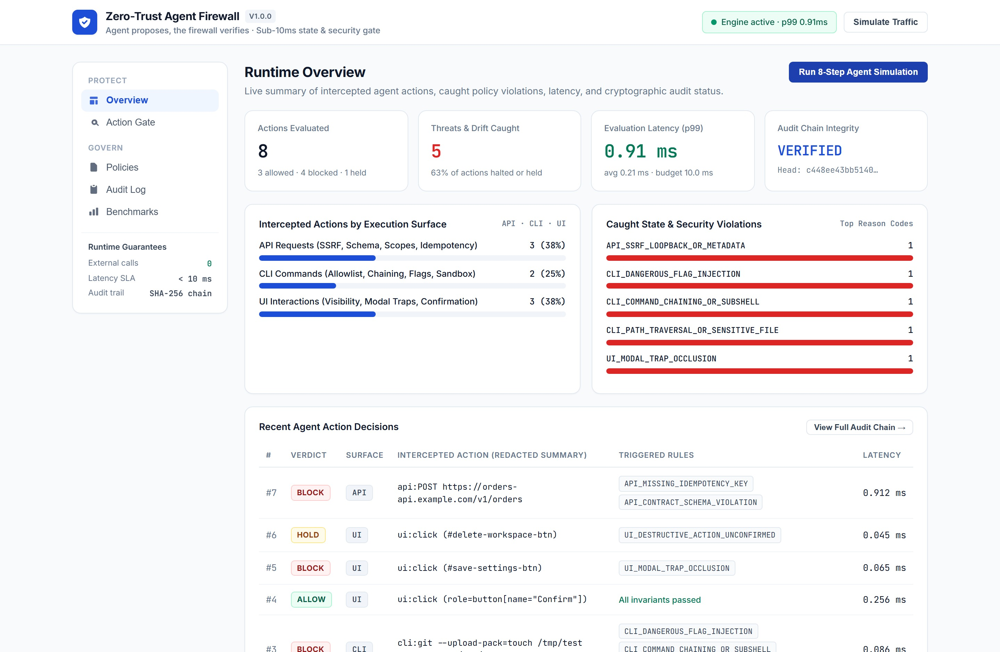
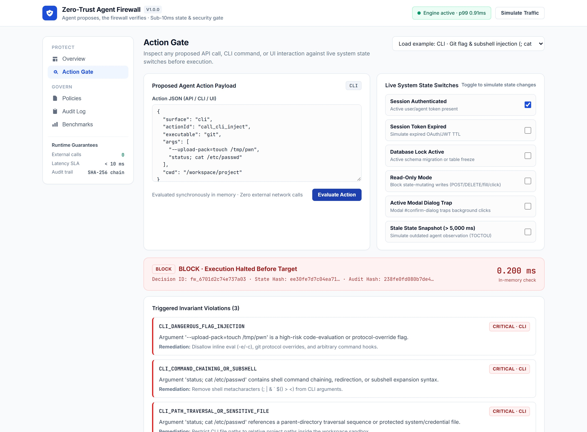
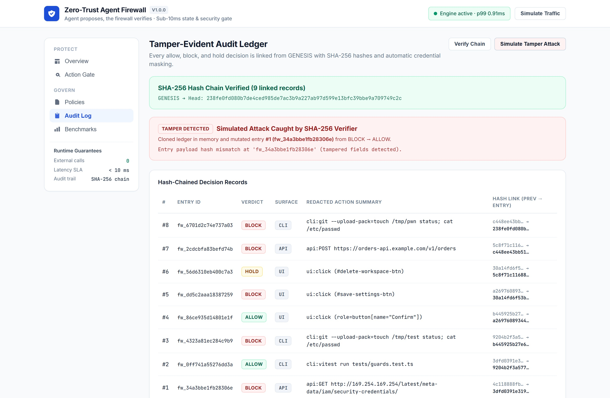
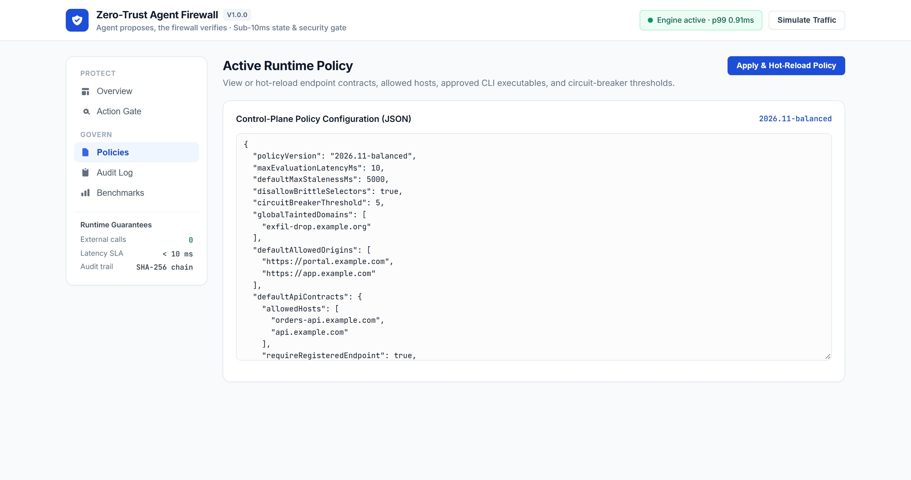
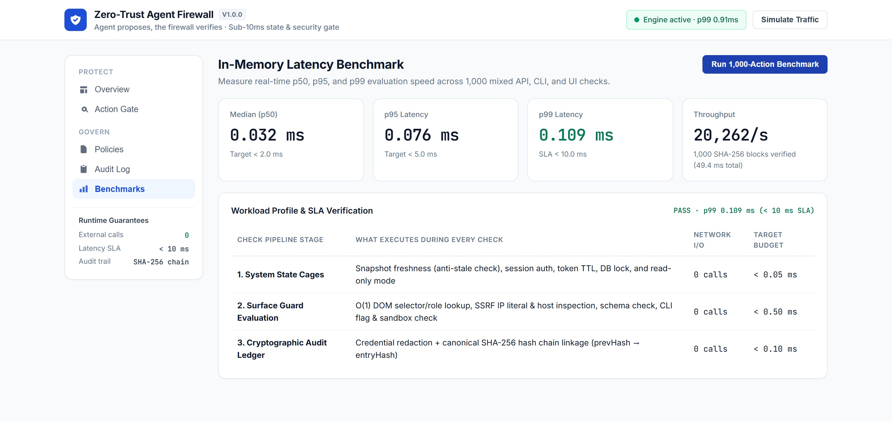

# Zero-Trust Agent Firewall

[](https://github.com/abul-lab/Zero-Trust-Agent-Firewall/actions/workflows/ci.yml)
[](LICENSE)
[](package.json)

**A deterministic runtime firewall for every action an AI agent tries to take.** Before an agent executes an API call, runs a command-line binary, or clicks an element in a browser, the firewall checks the proposed action in memory (p99 0.109 ms in the recorded benchmark run, see `docs/images/firewall-benchmarks.jpg`) against live system state and security rules—allowing valid actions, halting unsafe or drifted ones, pausing destructive actions for human sign-off, and recording every decision in a tamper-evident SHA-256 audit chain.

> **The agent proposes, the firewall verifies.**
> AI models plan multiple steps ahead without knowing whether a user session just expired, a database lock started, an endpoint schema drifted, or a modal dialog covered the screen. Deterministic state and security rules decide in sub-millisecond memory whether an action is safe to run right now—with zero external model calls.

---

## Why

Teams giving tools to AI agents face four recurring operational failures:

| Gap | What It Costs |
| :--- | :--- |
| **Agents act on stale state.** A session expires, a migration lock starts, or a modal dialog appears *after* the model planned its next step. | Broken workflows, unintended writes during freezes, and cascading multi-step failures. |
| **Tool calls are trusted by default.** Untrusted context can steer an agent into calling internal metadata IPs (`169.254.169.254`), chaining shell commands (`;`), or traversing outside the workspace. | Server-side request forgery (SSRF), command injection, and credential exposure. |
| **Using a second AI model as a "judge" is slow and probabilistic.** Calling another cloud model before every micro-action adds network round-trip delay to every action (not measured here) and sends live state externally. | Sluggish agent loops, compounding token costs, and sensitive runtime state leaving your environment. |
| **Execution logs are easy to alter and hard to audit.** Standard stdout logs mix raw secrets with unstructured text and offer no proof against tampering. | Compliance gaps and leaked tokens in observability pipelines. |

---

## What It Does

| Capability | How It Works |
| :--- | :--- |
| **Live System State Cages** | Verifies snapshot freshness (anti-stale state), active authentication, token expiration, required permission scopes, active database locks, and read-only mode before any tool runs. |
| **API Request Guard** | Blocks loopback, private-network, IPv6-mapped, hex/integer-obfuscated, and cloud-metadata SSRF targets; checks allowed hosts; enforces HTTP methods, `Idempotency-Key` headers, and endpoint request schemas; blocks outbound credential leaks. |
| **CLI Command Guard** | Enforces binary allowlists; blocks shell interpreters and network exfiltration tools; blocks command chaining (`;`, `&&`, `|`, `$()`), code-evaluation and protocol-override flags (`--eval`, `-c`, `--upload-pack`), linker hijacking (`LD_PRELOAD`), and paths outside the workspace sandbox. |
| **UI Action Guard** | Indexes live DOM snapshots in $O(1)$ by CSS selector, `data-testid`, and ARIA role; blocks actions on missing, hidden, disabled, `readonly`, `aria-busy`, or overlay-obscured elements; catches active modal focus traps; holds destructive actions until human confirmation is attached. |
| **Runaway Loop Circuit Breaker** | Trips automatically after consecutive blocked attempts so a stuck or hijacked agent loop cannot hammer downstream services, with one-click or API reset. |
| **Runtime Policy Hot-Reload** | Loads and updates endpoint contracts, host allowlists, approved binaries, and thresholds in memory (`PUT /v1/policy`) without restarting the process or container. |
| **Tamper-Evident SHA-256 Audit Chain** | Links every `ALLOW`, `BLOCK`, and `HOLD` decision from `GENESIS` (`prevHash → entryHash`) with automatic credential masking (`[REDACTED]`) and non-blocking export to central logging systems. |
| **Interactive Runtime Console** | Built-in web UI for monitoring live interception metrics, testing actions against interactive state switches, managing active policies, verifying the SHA-256 audit chain, and running latency benchmarks. |

---

## Architecture



---

## Interface Tour

<table>
  <tr>
    <td></td>
    <td></td>
  </tr>
  <tr>
    <td></td>
    <td></td>
  </tr>
  <tr>
    <td colspan="2"></td>
  </tr>
</table>

---

## Built-In Protection Coverage

| Surface | Verified Invariants | Example Reason Codes |
| :--- | :--- | :--- |
| **System & Session State** | Snapshot staleness window, session authentication, token TTL, endpoint scopes, active database locks, read-only mode, consecutive-block circuit breaker | `STATE_SNAPSHOT_STALE`, `SESSION_UNAUTHENTICATED`, `SESSION_EXPIRED`, `DATABASE_LOCK_ACTIVE`, `READONLY_MODE_VIOLATION`, `CIRCUIT_BREAKER_OPEN` |
| **API Requests** | Cloud metadata & private-network SSRF (IPv4, IPv6, integer/hex/octal IPs), host allowlist, OpenAPI path & method matching, body/query schema validation, `Idempotency-Key` enforcement, tainted domains, secret leaks | `API_SSRF_LOOPBACK_OR_METADATA`, `API_HOST_NOT_ALLOWLISTED`, `API_CONTRACT_SCHEMA_VIOLATION`, `API_MISSING_IDEMPOTENCY_KEY`, `API_TAINTED_SINK_DOMAIN` |
| **CLI Commands** | Executable allowlist, shell & network-tool blocking, command chaining & subshell syntax, inline eval & git protocol-override flags, linker environment variables, path traversal & sensitive files, sandbox working directory | `CLI_EXECUTABLE_NOT_ALLOWLISTED`, `CLI_COMMAND_CHAINING_OR_SUBSHELL`, `CLI_DANGEROUS_FLAG_INJECTION`, `CLI_PATH_TRAVERSAL_OR_SENSITIVE_FILE`, `CLI_WORKDIR_OUTSIDE_SANDBOX` |
| **UI Interactions** | Element existence, visibility, enabled state, `readonly`, `aria-busy`, toast/overlay obstruction, active modal focus-trap occlusion, brittle positional XPath chains, human confirmation for destructive controls | `UI_ELEMENT_NOT_FOUND`, `UI_ELEMENT_DISABLED`, `UI_ELEMENT_OBSCURED`, `UI_MODAL_TRAP_OCCLUSION`, `UI_DESTRUCTIVE_ACTION_UNCONFIRMED` |

---

## Quick Start

**Docker:**

```bash
docker compose up --build -d
```

**Local Node.js (20+):**

```bash
npm install
npm run serve
```

Open **http://localhost:4100** for the Runtime Console and HTTP API (`/healthz`, `/v1/evaluate`, `/v1/policy`, `/v1/audit`, `/v1/audit/verify`).

---

## Honest Limits

1. **Snapshot Timing Window**: The firewall evaluates the state snapshot provided at check time and rejects snapshots older than `maxStalenessMs` (default `5,000 ms`). A state transition that occurs *between* snapshot capture and tool execution cannot be observed unless fresh state is sampled immediately before evaluation.
2. **DNS Rebinding**: To stay synchronous and sub-millisecond with zero external network calls during evaluation, hostnames and IP literals (IPv4, IPv6, hex/integer/octal) are validated in memory rather than via live DNS resolution. Pair `allowedHosts` with a network egress proxy that pins resolved IPs when calling external domains.
3. **Structural Rules vs. Business Intent**: Deterministic rules verify that an action is permitted, state-valid, and schema-compliant—not whether ordering `40` units instead of `4` matched conversational intent when both satisfy `[1, 50]`. Mark high-impact operations as `destructive: true` so the firewall returns a `HOLD` verdict requiring explicit human confirmation.

---

## License

[MIT](LICENSE)
